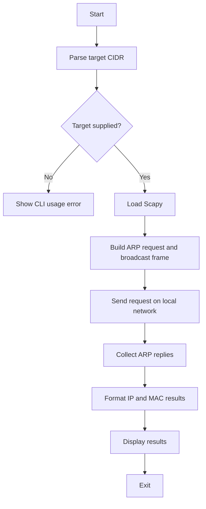

# Network Scanner


## Get this repository

Clone the current project from its canonical GitHub location, then follow the installation and usage steps below.

```bash
git clone https://github.com/cyberworlduniversity/Network_scanning.git
cd Network_scanning
```

A Python 3 command-line utility that discovers responding IPv4 hosts on a local network using ARP. Use it only on networks you own or have explicit permission to assess.

## Requirements

- Python 3.10+
- Scapy (installed from `requirements.txt`)
- A network interface connected to the target LAN
- Appropriate packet-capture privileges (often administrator/root)

## Install

```bash
python -m venv .venv
# Linux/macOS
source .venv/bin/activate
# Windows PowerShell: .venv\Scripts\Activate.ps1
python -m pip install --upgrade pip
python -m pip install -r requirements.txt
```

## Run

```bash
python network_scanner.py --help
sudo python network_scanner.py --target 192.168.1.0/24
```

On Windows, open an elevated terminal and run the command without `sudo`. Replace the example subnet with a network you are authorized to scan. ARP discovery works on the local Layer-2 network; it is not an Internet-wide scanner.

## Tests

The unit tests validate argument parsing and output formatting without transmitting network packets:

```bash
python -m unittest discover -v
python -m compileall -q .
```

GitHub Actions runs these checks on pushes and pull requests. A successful unit-test run does not prove that packet capture works on every operating system or network adapter.

## Program flow



## Project files

- `network_scanner.py` — scanner and CLI entry point
- `requirements.txt` — runtime dependency
- `test_network_scanner.py` — offline unit tests
- `.github/workflows/python-ci.yml` — automated CI checks

## Troubleshooting

- **Scapy import error:** activate the virtual environment and install `requirements.txt`.
- **Permission denied:** use an elevated terminal and verify packet-capture permissions.
- **No hosts found:** verify the subnet, interface, local network, and firewall settings.
- **Unsupported adapter:** install the packet-capture driver required by your operating system.

## Safety

Only scan networks for which you have explicit authorization. The tool sends ARP discovery traffic and does not attempt exploitation or authentication.
